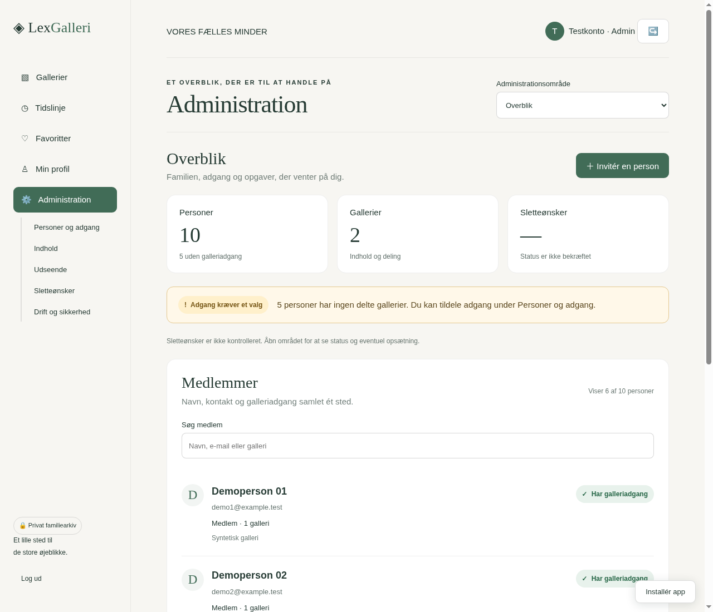
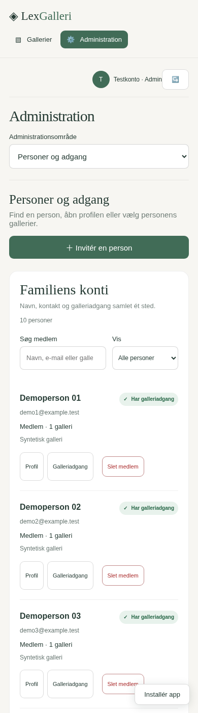

# LexGalleri: samlet administration og medlemsoversigt

Administrationen samles ét sted med en søgbar medlemsoversigt, galleriadgang og tydelig tilbagemelding ved ændringer. Dette trin gælder LexGalleri. Fiskerhyttens tilsvarende arbejde følger senere.

## Skærmbilleder

Skærmbillederne er taget fra den fungerende kode med opdigtede testkonti i en isoleret browser. Der er ingen rigtige medlemsoplysninger eller private billeder i eksemplerne.

- [Overblik på pc](docs/design/administration-overblik-desktop.png)
- [Medlemsoversigt på mobil](docs/design/administration-medlemmer-mobil.png)

## Navigation og medlemskort

Sidepanelet har én indgang: **Administration**. Administrationsområdet kan vælges i en tydelig menu, som også fungerer på mobil: Overblik, Personer og adgang, Indhold, Udseende, Sletteønsker og Drift og sikkerhed.

Overblikket viser antal konti og gallerier, status for sletteønsker og op til seks medlemskort. Søgningen kan finde alle konti, også dem der ligger uden for de første seks. **Vis alle medlemmer** åbner den fulde oversigt.

Et medlemskort viser navn, e-mail, rolle, galleriantal og gallerinavne. Status betyder:

- **Fuld adgang:** Kontoen er administrator.
- **Har galleriadgang:** Der er tildelt adgang til mindst ét galleri.
- **Ingen galleriadgang:** Kontoen har ingen delte gallerier. Det er en oplysning, der kan kræve et valg fra admin.
- **Ikke kontrolleret:** Serverens oplysninger kan ikke bekræftes. Der gættes ikke på adgang eller nulværdier.

Listen viser oprettede konti. Den viser ikke en ukendt invitation som en person uden login. Det eksisterende invitationsforløb bevares med personligt engangslink og de valgte rettigheder. Personer kan findes efter navn, e-mail eller galleri, og den fulde oversigt kan filtreres efter administratorer eller personer uden galleriadgang.

## Rettigheder og gemmestatus

Galleriadgang ændres med de eksisterende API'er og rettigheder. Andre rettigheder kan først vælges, når **Se galleri** er valgt. Administratorkonti beholder deres eksisterende fulde adgang.

Hvert galleri har sin egen gemmestatus. En valgt afkrydsning er ikke i sig selv en gemt rettighed.

- Ændringer vises som **ikke gemt**.
- Under en forespørgsel vises **Gemmer rettigheder…**. Flere samtidige forespørgsler fra formularen er spærret.
- **Gemt** vises først efter serverens bekræftelse.
- En fejl bliver vist ved det konkrete galleri. De indtastede valg bevares til genforsøg.
- **Fortryd ugemte valg** gendanner de senest bekræftede rettigheder uden at sende en ændring til serveren.
- Ved lukning med ugemte ændringer vælges enten **Bliv her** eller **Luk uden at gemme**. Siden advarer også ved forsøg på at forlade den med ugemte rettigheder.

Den faste handlingsbjælke kan gemme flere ændrede gallerier. De gemmes ét ad gangen. En fejl stopper de resterende forespørgsler og viser, hvor mange der blev gemt. Det er ikke én fælles databasetransaktion; allerede bekræftede ændringer bevares, og de resterende valg kan genforsøges.

Medlemskortet opdateres efter en bekræftet ændring. Der hentes ikke en ny medlemsliste for at vise, at rettighederne blev gemt. Billeder og eksisterende galleri-/kontodata ændres ikke af søgning eller filtrering.

## Oplysninger og sikkerhed

Kun admin får administrationsindgangen. Eksisterende serverkontrol af roller, gallerier, MFA, profiler og sletning bevares. Der ændres ingen PHP-programmer eller SQL-migreringer i denne leverance.

Felter til Authenticator bruger `inputmode="numeric"` og tilbyder derfor taltastatur på mobil. Det gælder login, bekræftelse ved opsætning og administratorbekræftelser. Ved login og administratorbekræftelser åbner **Brug reservekode** et almindeligt tastatur, så bogstaver og bindestreger kan indtastes. Skiftet sender ingen kode og bevarer feltets indhold. Opsætning af en ny Authenticator kræver fortsat den sekscifrede kode.

En fejl ved læsning af medlemsoversigten giver en fejlbesked og **Prøv igen**, ikke en tom liste med et grønt OK. Gamle svar må ikke overskrive en side, som brugeren har navigeret til imens.

Drift og sikkerhed viser de funktioner, som serverens status faktisk oplyser, at den understøtter. Det er ikke en påstand om kontrol af backups, ledig diskplads eller alle funktioner på den virkelige server. Authenticator og reservekoder administreres gennem den eksisterende profil.

Sletning af medlemmer og medier samt designpakker beholder deres eksisterende bekræftelser og sikkerhedsgrænser. Medlemmer kan fortsat kun markere egne medier til admins godkendelse.

## Verifikation

Der bruges syntetiske konti og lokale browserfixtures. Prøverne dækker søgning, filtre, 320/390 px mobilvisning, oversigten på pc, serverbekræftet gemning, fejl og delvis gemning, genforsøg, fortrydelse og sene svar efter navigation. De eksisterende browserforløb for billeder, video, profiler, invitationer, rettigheder og sletning køres sammen med de nye.

En ny livekontrol af webhotellet er ikke udført. Skærmbillederne er udviklingsvisninger af den nye kode, ikke billeder fra produktionsinstallationen.

Lokale resultater for denne version: **67 browserkontroller, 44 medie-/dialogprøver, 21 konto-/sikkerheds-UI-prøver og 13 PWA-prøver bestået**. Browserprøver kontrollerer attributten til numerisk tastatur og skiftet til reservekode; det er ikke en fysisk telefonprøve.
