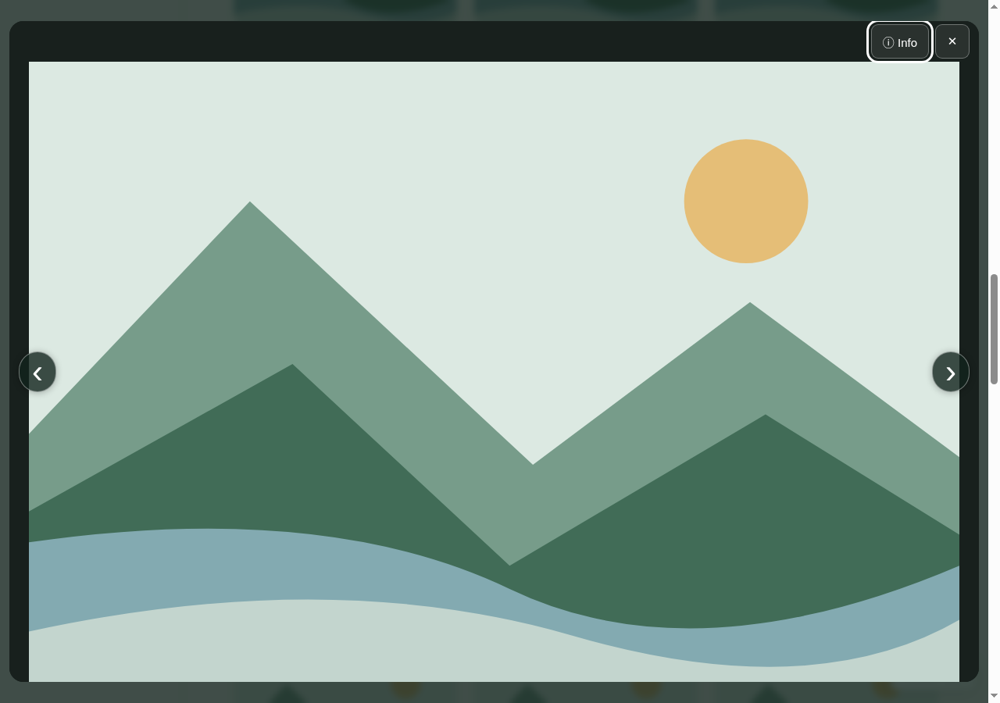
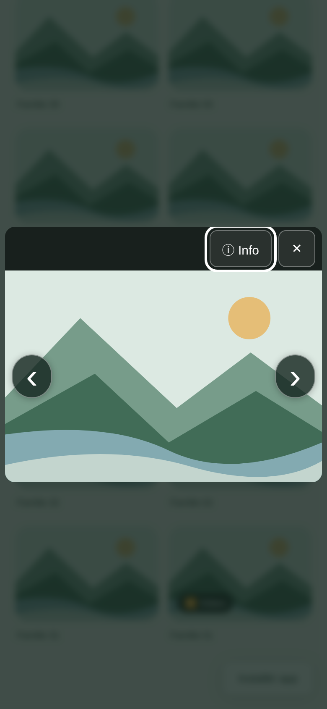
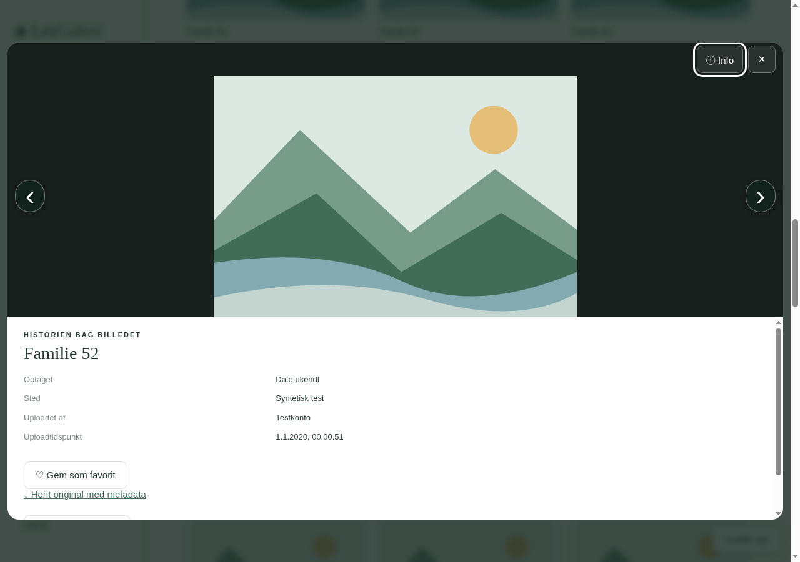

# Kompakt billedvisning

Billedet bruger hele visningens bredde. Pilene sidder oven på billedet, og **Info** samler titel, dato, sted, uploader og øvrige oplysninger samt de handlinger, brugeren har adgang til. Info er lukket fra start.

Info åbner og lukker uden at hente billedet igen eller genstarte en video. På pc kan man bruge venstre og højre piletast; tekstfelter og videoens egne tastaturkontroller beholder deres normale funktion. Escape lukker billedvisningen, mens oversigten, søgningen og scrollpositionen bevares.

Skærmbillederne nedenfor stammer fra en rigtig browser med genererede testbilleder og syntetiske konti. De indeholder ingen familiebilleder eller private loginoplysninger.

## Pc

## Mobil

## Oplysninger åbnet

